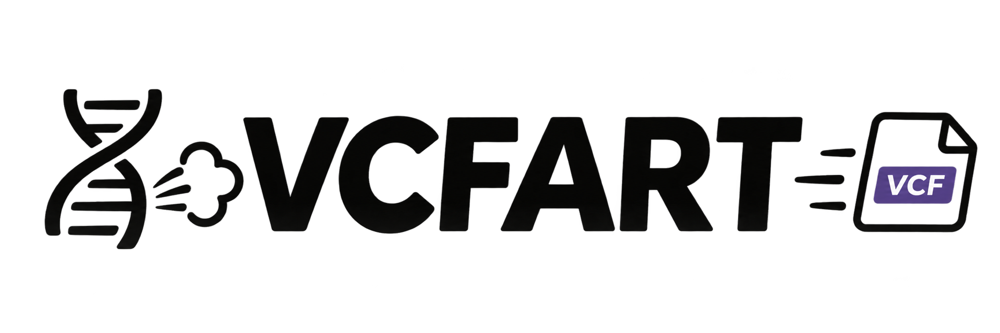
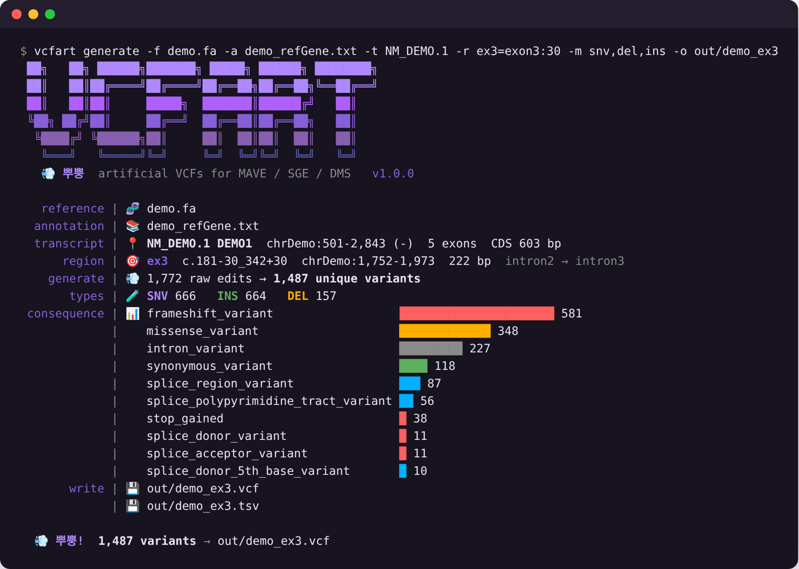

<p align="center">
  <picture>
    <source media="(prefers-color-scheme: dark)" srcset="logo/logo_dark.png">
    
  </picture>
</p>

<p align="center">
  <b>VCF ARTificial</b> — 뿌아아아아앙~, 전사체의 지정 구간에서 만들 수 있는 모든 변이를, 바로 annotation 가능한 VCF로 뿜어냅니다.<br>
  <i>뿌뿡 💨 — MAVE, saturation genome editing(SGE), deep mutational scanning(DMS), SpliceAI 스캔용.</i>
</p>

<p align="center">
  
  
  
  <a href="https://cleancham-lab.github.io/VCFART/"></a>
</p>

[English](README.md) | **한국어** | [홈페이지](https://cleancham-lab.github.io/VCFART/)

---

## 💨 무엇을 하나요 뿌뿡

reference genome(hg19 / hg38), 전사체(`NM_007294.4`), 그리고 평소 쓰던 방식 그대로의 구간
(`c.5075-100_c.5152+100`, `exon17:100`, `chr17:43063774-43064051`)만 주면 아래 파일을 만듭니다.

| 파일 | 내용 |
|---|---|
| `PREFIX.vcf` | 모든 변이. VCF 4.2, 좌표 정렬, left-normalization, 중복 제거, REF는 입력 FASTA로 확인 |
| `PREFIX.tsv` | 변이 한 줄씩: HGVS c., HGVS p., consequence, exon/intron 위치, 생성 방식, 구간 라벨 |
| `PREFIX.oligos.fa` | *(선택, `--oligo`)* 변이가 들어간 서열(transcript 방향) + 어댑터 — oligo pool 주문용 |

VCF는 **SpliceAI, ANNOVAR, VEP, CADD, AlphaMissense 조회, bcftools**에 그대로 들어가므로,
MAVE 라이브러리 전체를 실험 전(또는 후)에 *in silico*로 점수 매길 수 있습니다.

<p align="center"></p>

### ✨ 기능 뿡

- **전사체 기준 좌표** — HGVS c./n. 번호 체계 전체 지원: CDS, 5′/3′ UTR(`c.-30`, `c.*12`),
  인트론 offset(`c.5075-1`, `c.-30+5`), 전사체 바깥 위치까지. minus strand 유전자도 자동 처리
  (염기 상보 변환을 손으로 할 필요 없음).
- **변이 생성기**
  - `snv` — 모든 위치에서 나머지 3개 염기로 치환 (기본값)
  - `del` — 원하는 길이의 결실 (`--del-sizes 1,2,3`)
  - `ins` — 모든 염기 사이에 가능한 모든 k-mer 삽입 (`--ins-sizes 1`)
  - `codon` — DMS 방식 코돈 치환: 아미노산마다 코돈 하나 + Ter + 동의 코돈 대조군(`--codon-set aa`),
    63개 코돈 전부(`all`), NNK(`nnk`). 코돈은 인간 codon usage 또는 최소 염기 변경(`--codon-pick min-edit`)으로 선택
- **정확한 indel 처리** — VCF는 anchor 염기를 붙여 left-normalization. 서열상 같은 변이
  (예: `CCCCCC` 중 아무 C나 하나 결실)는 한 줄로 합침. HGVS는 3′ rule 적용(`c.24del`, `c.13_15dup`).
- **변이별 annotation** — HGVS c., 예측 HGVS p.(`p.Trp6Ter`, `p.Glu5del`, `p.Glu3LysfsTer?`,
  `p.Ter9GlnextTer5`, `p.Met1?`), Sequence Ontology consequence(splice donor/acceptor, donor 5번째 염기,
  polypyrimidine tract, splice region, missense 등), 위치(`intron16`, `exon17`).
- **oligo 라이브러리 출력** — 변이별 mutant 서열(+ WT), 양쪽 padding과 5′/3′ 어댑터 옵션.
- **이미 가진 파일 그대로 사용** — ANNOVAR `humandb/hg38_refGene.txt`를 그대로 읽음. UCSC
  `refGene` / `ncbiRefSeq` 테이블, RefSeq·GENCODE GTF(ENST)도 지원. `chr16`과 `16` 같은 이름 차이는 자동 매칭.
- **안전장치** — CDS가 ATG로 시작/stop codon으로 끝나지 않거나 인트론이 GT-AG가 아니면 경고
  (= genome build와 annotation이 서로 다를 가능성).
- **의존성 없음** — 순수 Python ≥ 3.8 표준 라이브러리만 사용. `.fai` 인덱스도 직접 읽고 만듦.
- **보기 좋은 실행 로그** — MultiQC 스타일 컬러 로그 + consequence 막대그래프. 파이프로 넘기거나
  `--no-color` / `NO_COLOR=1`이면 색이 꺼짐.

---

## 설치 뿌뿡

```bash
python -m pip install git+https://github.com/CleanCham-lab/VCFART.git
# 또는
git clone https://github.com/CleanCham-lab/VCFART.git
cd VCFART && python -m pip install -e .
vcfart --version
```

## 🚀 바로 해보기 (10초, 내장 demo genome)

```bash
cd examples
./run_demo.sh          # examples/out/ 에 *.vcf / *.tsv / *.oligos.fa 생성
```

## 🧬 실제 데이터 뿌뿌뿡

```bash
# 1. 전사체 테이블 — ANNOVAR 것을 그대로 쓰거나, UCSC에서 한 번 내려받기
vcfart fetch-annotation -b hg38          # -> ~/.vcfart/hg38.ncbiRefSeq.txt.gz
#   (SSL 검사 프록시 환경이면 --insecure, 또는 출력되는 URL을 wget으로 받기)

# 2. 엑손/인트론 지도를 c. 좌표와 genomic 좌표로 확인
vcfart info -b hg38 -t NM_007294.4 -f hg38.fa

# 3. 생성: BRCA1 엑손 17(c.5075-c.5152) + 양쪽 인트론 100 bp
vcfart generate -f hg38.fa -b hg38 -t NM_007294.4 \
    -r int16=c.5075-100_c.5075-1 \
    -r ex17=c.5075_c.5152 \
    -r int17=c.5152+1_c.5152+100 \
    -o BRCA1_ex17

# 같은 구간 짧게 (엑손 번호는 annotation의 전사체 기준 — `vcfart info`로 확인)
vcfart generate -f hg38.fa -a humandb/hg38_refGene.txt -t NM_007294 -r exon17:100 -o BRCA1_ex17
```

### 🎯 구간 문법 (`-r`, 여러 번 사용 가능, `LABEL=` 접두어 선택)

| 형식 | 의미 |
|---|---|
| `c.5075-100_c.5075-1` 또는 `c.5075-100_5075-1` | HGVS c. 구간 (인트론 offset, `c.-N`, `c.*N` 가능) |
| `c.5075` | 한 위치 |
| `n.10_n.250` | non-coding 전사체 (NR_ / lncRNA) |
| `g.43063774_43064051` 또는 `chr17:43,063,774-43,064,051` | genomic 좌표, 1-based, 양끝 포함 |
| `exon17`, `exon17:100`, `exon17:100:50` | 엑손(전사체 순서), + 양쪽 flank, + 5′·3′ flank 따로 |
| `intron16` | 인트론 전체 |
| `cds` | c.1부터 stop codon 끝까지 (`--exonic-only`와 함께 쓰면 CDS만) |

구간은 genome 상의 연속 구간이므로, 여러 엑손에 걸친 `c.1_c.600`은 사이 인트론까지 포함합니다(실행 로그에 표시).
엑손 염기만 원하면 `--exonic-only`를 붙이세요.

### ⚙️ 주요 옵션 (전체는 `vcfart generate -h`)

| 옵션 | 기본값 | |
|---|---|---|
| `-m snv,del,ins,codon` | `snv` | 실행할 변이 생성기 |
| `--del-sizes` / `--ins-sizes` | `1` | indel 길이 (쉼표로 구분) |
| `--codon-set aa\|all\|nnk` / `--codon-pick usage\|min-edit` | `aa` / `usage` | 코돈 모드 |
| `--exonic-only` | 꺼짐 | 엑손 위치만 (cDNA / CDS saturation) |
| `--sites-only` | 꺼짐 | 더미 `FORMAT/GT` 샘플 열 생략 (기본은 ANNOVAR 호환용 `GT=0/1`) |
| `--id hgvs\|index\|none` | `hgvs` | VCF ID 열 (기본 `c.5075-1G>C` 형태) |
| `--oligo --oligo-pad N --adapter5 SEQ --adapter3 SEQ` | 꺼짐 | oligo 라이브러리 FASTA |
| `--oligo-strand transcript\|plus` | `transcript` | oligo 서열 방향 |
| `--chrom` | — | 전사체가 여러 위치에 매핑될 때(PAR, alt contig) 위치 선택 |

### 🏷️ VCF INFO 필드

`VA_TX`, `VA_GENE`, `VA_HGVSc`, `VA_HGVSp`(`=`는 VEP처럼 `%3D`로 기록), `VA_CSQ`,
`VA_REGION`, `VA_TYPE`(SNV/MNV/DEL/INS/DELINS), `VA_ORIGIN`(생성기), `VA_SET`(구간 라벨).

### 🔗 후속 분석 예시

```bash
spliceai -I BRCA1_ex17.vcf -O BRCA1_ex17.spliceai.vcf -R hg38.fa -A grch38
perl table_annovar.pl BRCA1_ex17.vcf humandb/ -buildver hg38 -out BRCA1_ex17 \
     -protocol refGene -operation g -vcfinput -remove -nastring .
vep -i BRCA1_ex17.vcf --fasta hg38.fa --cache --hgvs --everything -o BRCA1_ex17.vep.txt
```

---

## 📏 표기 규칙 (한 번만 읽어두세요)

- **VCF**는 bcftools norm 방식으로 left-align하고, indel에는 바로 앞 염기를 anchor로 붙입니다.
  서열상 같은 변이는 한 번만 쓰며, 그 변이를 만든 구간/생성기는 `VA_SET`/`VA_ORIGIN`에 모두 기록됩니다.
- **HGVS c.**는 genomic 서열 위에서 전사체 방향 3′ rule을 적용하며, 엑손/인트론 경계도 넘어갑니다
  (인트론에서 만든 삽입이 결과 서열이 같으면 엑손 좌표로 표기될 수 있음). TSV에는 원래 생성된 구간 라벨이 남습니다.
- **HGVS p.**는 reference CDS 기준 예측값입니다(splicing 영향은 계산하지 않음 — 그건 SpliceAI의 몫).
  splice site를 바꾸거나 엑손/인트론 경계에 걸친 변이는 `p.?`.
- **코돈 모드**는 인트론으로 나뉜 코돈을 건너뜁니다(로그에 개수 표시).
- reference가 `N`인 위치는 건너뜁니다.
- FASTA와 annotation은 같은 genome build를 쓰세요 — 다르면 VCFART가 경고합니다.

## ✅ 검증

- 저자들이 쓰던 기존 in-house MAVE 스크립트 결과를 그대로 재현: minus strand 유전자의 444 bp
  인트론–엑손–인트론 구간(hg38)에서 SNV 1,332개의 POS/REF/ALT와 c. 표기가 모두 동일. 같은 루프 로직을
  합성 서열로 테스트에 포함(`tests/test_prototype_regression.py`).
- 실제 hg38 실행(`hg38.fa` + ANNOVAR `hg38_refGene.txt`): DRC1(NM_145038, plus strand) CDS의 SNV
  6,669개 전부가 ANNOVAR refGene의 c./p. annotation과 일치 (start-loss 9개, stop-loss 8개 포함,
  `examples/compare_annovar.py`).
- 합성 plus/minus strand 유전자의 모든 CDS SNV를 독립적인 번역 결과와 대조
  (missense / synonymous / nonsense / stop-loss 연장 / start-loss).
- 무작위 indel: 원래 표현, left-normalized 표현, HGVS 3′-shift 표현이 모두 같은 genome을 만드는지 확인.

```bash
python -m pip install pytest && python -m pytest

# 내 결과를 ANNOVAR와 대조
perl table_annovar.pl X.vcf humandb/ -buildver hg38 -out X_annovar -remove \
     -protocol refGene -operation g -nastring . -vcfinput
python examples/compare_annovar.py X.tsv X_annovar.hg38_multianno.txt
```

## 🧰 관련 도구

VCFART는 일부러 작고 CLI 중심으로 만들었습니다. PAM/protection edit까지 포함한 SGE oligo 설계
파이프라인이 필요하면 [VaLiAnT](https://academic.oup.com/bioinformatics/article/38/4/892/6429268)(Wellcome Sanger),
R/Bioconductor 기반으로 MANE 전사체 전체의 SNV를 시뮬레이션하려면 `rvarsim`, MAVE read 수준의 variant calling은
[satmut_utils](https://pypi.org/project/satmut-utils/)를 참고하세요.

## 📖 인용

VCFART가 도움이 되었다면 저장소를 인용해 주세요 뿌ㅇㅇㅇ우우웅 (`CITATION.cff` 참고).

## 📄 라이선스

MIT © 2026 Seung Won Chae

## 👤 만든 사람

**채승원 (Seung Won Chae)** — 서울대학교병원 진단검사의학과 분자진단검사실 · 서울대학교 암연구소
