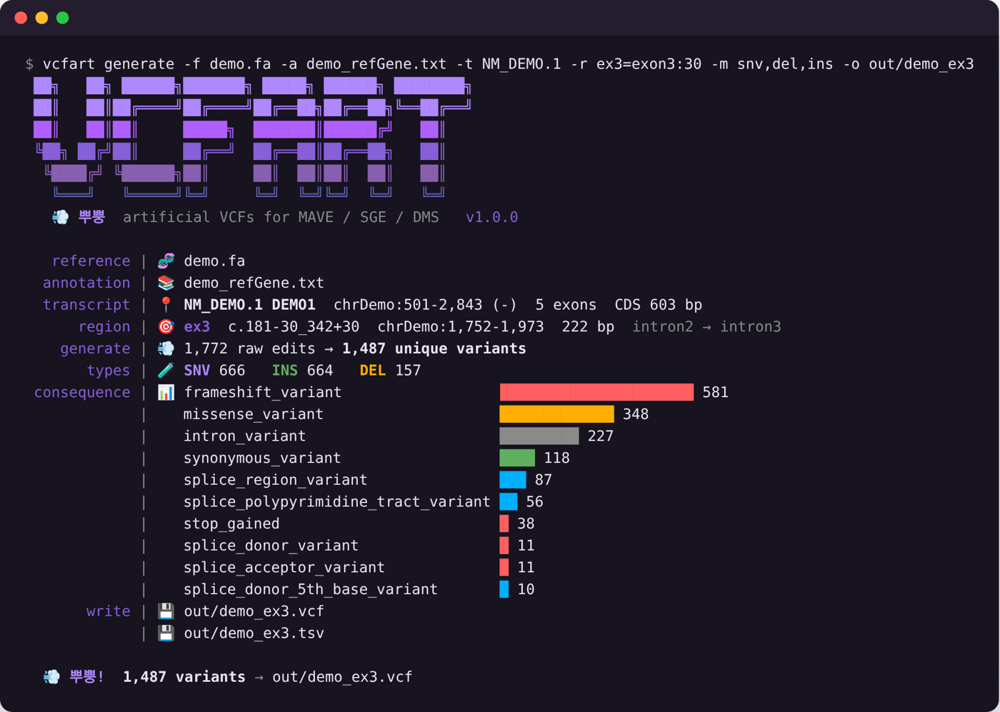

<p align="center">
  <picture>
    <source media="(prefers-color-scheme: dark)" srcset="https://raw.githubusercontent.com/CleanCham-lab/VCFART/main/logo/logo_dark.png">
    
  </picture>
</p>

<p align="center">
  <b>VCF ARTificial</b> — blow out every possible variant of a transcript region as a ready-to-annotate VCF.<br>
  <i>뿌뿡~💨 — for MAVE, saturation genome editing (SGE), deep mutational scanning (DMS) and SpliceAI scans.</i>
</p>

<p align="center">
  <a href="https://pypi.org/project/vcfart/"></a>
  
  
  
  <a href="https://cleancham-lab.github.io/VCFART/"></a>
</p>

**English** | [한국어](https://github.com/CleanCham-lab/VCFART/blob/main/README.ko.md) | [Homepage](https://cleancham-lab.github.io/VCFART/)

---

## 💨 What it does

Give VCFART a reference genome (hg19 / hg38), a transcript (`NM_007294.4`) and a range written the way
you already think about it (`c.5075-100_c.5152+100`, `exon17:100`, `chr17:43063774-43064051`).
It writes:

| file | content |
|---|---|
| `PREFIX.vcf` | every variant, VCF 4.2, sorted, left-normalized, de-duplicated, REF checked against your FASTA |
| `PREFIX.tsv` | one row per variant: HGVS c., HGVS p., consequence, exon/intron, generator, region label |
| `PREFIX.oligos.fa` | *(optional, `--oligo`)* mutant sequences in transcript orientation, with your adapters — an oligo-pool order sheet |

The VCF goes straight into **SpliceAI, ANNOVAR, VEP, CADD, AlphaMissense lookups, bcftools** …
so you can score a whole MAVE library *in silico* before (or after) the wet lab.

<p align="center"></p>

### ✨ Features

- **Transcript-aware coordinates** — full HGVS c./n. numbering: CDS, 5′/3′ UTR (`c.-30`, `c.*12`),
  intronic offsets (`c.5075-1`, `c.-30+5`), positions beyond the transcript; minus-strand genes handled
  (no more manual complementing of bases).
- **Mutation generators**
  - `snv` — all 3 alternative bases at every position (default)
  - `del` — deletions of any lengths (`--del-sizes 1,2,3`)
  - `ins` — insertions of every k-mer between every pair of bases (`--ins-sizes 1`)
  - `codon` — DMS-style codon swaps: one codon per amino acid + Ter + a synonymous control
    (`--codon-set aa`), all 63 codons (`all`) or NNK (`nnk`); codon choice by human usage or fewest
    nucleotide edits (`--codon-pick min-edit`)
- **Correct indel bookkeeping** — VCF records are left-normalized with an anchor base; equivalent edits
  (e.g. deleting any C of `CCCCCC`) collapse into one record; HGVS follows the 3′ rule
  (`c.24del`, `c.13_15dup`).
- **Annotation per variant** — HGVS c., predicted HGVS p. (`p.Trp6Ter`, `p.Glu5del`,
  `p.Glu3LysfsTer?`, `p.Ter9GlnextTer5`, `p.Met1?`), Sequence Ontology consequences
  (splice donor/acceptor, donor 5th base, polypyrimidine tract, splice region, missense, …) and region
  (`intron8`, `exon9`).
- **Oligo library output** — mutant window sequence per variant (+ WT), optional padding and 5′/3′ adapters.
- **Uses what you already have** — ANNOVAR `humandb/hg38_refGene.txt` works as-is; UCSC
  `refGene` / `ncbiRefSeq` tables; RefSeq or GENCODE GTF (ENST IDs). `chr16` vs `16` naming is matched automatically.
- **Safety checks** — warns when the CDS does not start with ATG / end with a stop or when introns lack
  GT-AG motifs (= genome build and annotation do not match).
- **Zero dependencies** — pure Python ≥ 3.9 standard library; reads/creates the `.fai` index itself.
- **Readable runs** — MultiQC-style coloured log with a consequence bar chart; colour turns off when
  piped, with `--no-color` or `NO_COLOR=1`.

---

## 📦 Install

```bash
python -m pip install vcfart
vcfart --version

# development version
python -m pip install git+https://github.com/CleanCham-lab/VCFART.git
```

## 🚀 Quick start (10 seconds, bundled demo genome)

```bash
git clone https://github.com/CleanCham-lab/VCFART.git && cd VCFART/examples
./run_demo.sh          # writes examples/out/*.vcf / *.tsv / *.oligos.fa
```

## 🧬 Real data

```bash
# 1. transcript table — reuse ANNOVAR's, or download once from UCSC
vcfart fetch-annotation -b hg38          # -> ~/.vcfart/hg38.ncbiRefSeq.txt.gz
#   (behind an SSL-inspecting proxy: add --insecure, or wget the URL it prints)

# 2. look at the exon/intron map in c. and genomic coordinates
vcfart info -b hg38 -t NM_007294.4 -f hg38.fa

# 3. generate: BRCA1 exon 17 (c.5075-c.5152) with 100 bp of each flanking intron
vcfart generate -f hg38.fa -b hg38 -t NM_007294.4 \
    -r int16=c.5075-100_c.5075-1 \
    -r ex17=c.5075_c.5152 \
    -r int17=c.5152+1_c.5152+100 \
    -o BRCA1_ex17

# same region, short form (exon numbers follow your transcript model -- check with `vcfart info`)
vcfart generate -f hg38.fa -a humandb/hg38_refGene.txt -t NM_007294 -r exon17:100 -o BRCA1_ex17
```

### 🎯 Region syntax (`-r`, repeatable, optional `LABEL=` prefix)

| form | meaning |
|---|---|
| `c.5075-100_c.5075-1` or `c.5075-100_5075-1` | HGVS c. range (intronic offsets, `c.-N`, `c.*N` allowed) |
| `c.5075` | a single position |
| `n.10_n.250` | non-coding transcripts (NR_ / lncRNA) |
| `g.43063774_43064051` or `chr17:43,063,774-43,064,051` | genomic, 1-based inclusive |
| `exon17`, `exon17:100`, `exon17:100:50` | exon (transcript order), + flank on both sides, + 5′ and 3′ flank |
| `intron16` | whole intron |
| `cds` | c.1 … end of the stop codon (use with `--exonic-only` for a CDS-only scan) |

A range is a contiguous stretch of the genome, so `c.1_c.600` across several exons includes the introns in
between (VCFART tells you). Add `--exonic-only` for cDNA-style saturation of exonic bases only.

### ⚙️ Main options (`vcfart generate -h` for all)

| option | default | |
|---|---|---|
| `-m snv,del,ins,codon` | `snv` | mutation generators to run |
| `--del-sizes` / `--ins-sizes` | `1` | indel lengths (comma-separated) |
| `--codon-set aa\|all\|nnk` · `--codon-pick usage\|min-edit` | `aa` · `usage` | codon mode |
| `--exonic-only` | off | keep only exonic positions (cDNA / CDS saturation) |
| `--sites-only` | off | drop the dummy `FORMAT/GT` sample column (default writes `GT=0/1`, ANNOVAR-friendly) |
| `--id hgvs\|index\|none` | `hgvs` | VCF ID column (`c.5075-1G>C` by default) |
| `--oligo --oligo-pad N --adapter5 SEQ --adapter3 SEQ` | off | oligo library FASTA |
| `--oligo-strand transcript\|plus` | `transcript` | oligo orientation |
| `--chrom` | — | choose the locus if a transcript maps to several (PAR, alt contigs) |

### 🏷️ VCF INFO fields

`VA_TX`, `VA_GENE`, `VA_HGVSc`, `VA_HGVSp` (`=` written as `%3D`, as VEP does), `VA_CSQ`,
`VA_REGION`, `VA_TYPE` (SNV/MNV/DEL/INS/DELINS), `VA_ORIGIN` (generator), `VA_SET` (region label).

### 🔗 Downstream examples

```bash
spliceai -I BRCA1_ex17.vcf -O BRCA1_ex17.spliceai.vcf -R hg38.fa -A grch38
perl table_annovar.pl BRCA1_ex17.vcf humandb/ -buildver hg38 -out BRCA1_ex17 \
     -protocol refGene -operation g -vcfinput -remove -nastring .
vep -i BRCA1_ex17.vcf --fasta hg38.fa --cache --hgvs --everything -o BRCA1_ex17.vep.txt
```

---

## 📏 Conventions (read once)

- **VCF** records are left-aligned (bcftools-norm style) with the preceding base as anchor for indels.
  Variants that are identical at the sequence level are written once; `VA_SET`/`VA_ORIGIN` list every
  region/generator that produced them.
- **HGVS c.** is described on the genomic sequence with the 3′ rule applied along the transcript,
  including across exon/intron borders (an insertion generated in the intron next to an exon can be
  reported with exonic coordinates when the resulting sequence is identical). The TSV keeps the region
  label it was generated from.
- **HGVS p.** is a prediction from the reference CDS (no splicing effect is modelled — that is what
  SpliceAI is for). Variants that change a splice site or cross an exon/intron border get `p.?`.
- **Codon mode** skips codons split by an intron (reported in the log).
- Positions with `N` in the reference are skipped.
- Use the same genome build for FASTA and annotation — VCFART warns loudly if they disagree.

## ✅ Validation

- Reproduces the authors' original in-house MAVE scripts base-for-base: on a 444-bp intron–exon–intron
  target of a minus-strand gene (hg38), all 1,332 SNVs have identical POS/REF/ALT and c. labels. The same
  loop logic runs in the test suite on a synthetic block (`tests/test_prototype_regression.py`).
- Real hg38 run (`hg38.fa` + ANNOVAR `hg38_refGene.txt`): all 6,669 CDS SNVs of DRC1 (NM_145038,
  plus strand) agree with ANNOVAR refGene c./p. annotation, including 9 start-loss and 8 stop-loss
  variants (`examples/compare_annovar.py`).
- Every CDS SNV of synthetic plus- and minus-strand genes is checked against an independent translation
  (missense / synonymous / nonsense / stop-loss extension / start-loss).
- Random indels: raw, left-normalized and HGVS-shifted representations produce the identical genome.

```bash
python -m pip install pytest && python -m pytest

# cross-check your own output against ANNOVAR
perl table_annovar.pl X.vcf humandb/ -buildver hg38 -out X_annovar -remove \
     -protocol refGene -operation g -nastring . -vcfinput
python examples/compare_annovar.py X.tsv X_annovar.hg38_multianno.txt
```

## 🧰 Related tools

VCFART is deliberately small and CLI-first. If you need a full SGE oligo-design pipeline with PAM/protection
edits, have a look at [VaLiAnT](https://academic.oup.com/bioinformatics/article/38/4/892/6429268) (Wellcome Sanger); for R/Bioconductor-based
all-SNV simulation across MANE transcripts see `rvarsim`; for MAVE read-level variant calling see
[satmut_utils](https://pypi.org/project/satmut-utils/).

## 📖 Citation

If VCFART helps your work, please cite the repository (see `CITATION.cff`).

## 📄 License

MIT © 2026 Seung Won Chae

## 👤 Author

**Seung Won Chae** — Molecular Diagnostics Laboratory, Department of Laboratory Medicine,
Seoul National University Hospital · Seoul National University Cancer Research Institute
